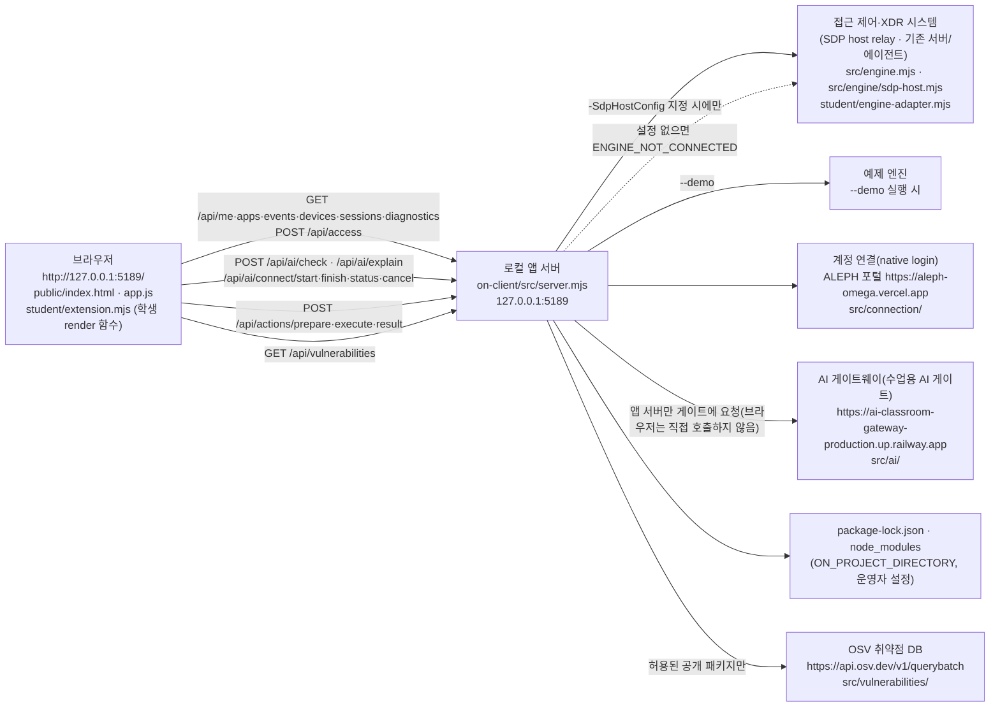

# 보안 Agent 「헤임달」 학생 실행 설명서와 구성도

이 문서는 학생이 작성했습니다. 시작 틀 0.2.14의 `on-client`(제공 앱 이름 「케셰브」)에 학생 화면을 구현한 보안 Agent 「헤임달」을 다른 사람이 같은 순서로 실행하고 확인할 수 있게 정리합니다. 제공 문서(`docs/STUDENT_LAUNCH_GUIDE.md`, `docs/CONNECTION_TROUBLESHOOT.md` 등)는 바꾸지 않았고, 이 문서는 그 내용을 이 프로젝트에서 실제로 확인한 결과와 함께 묶은 것입니다.

표기 규칙
- **실제 확인**: 학생 PC(Windows, VS Code, PowerShell, Chrome)의 실제 화면·터미널에서 본 결과입니다.
- **모의 점검**: Node.js에서 가짜 DOM과 모의 입력으로 학생 함수 출력만 확인한 결과입니다. 실제 화면이나 연결 결과가 아닙니다.
- **코드 확인**: 코드를 읽어 확인했지만 실행하지 않은 내용입니다.
- **미확인**: 실행하지 않았거나 확인할 수 없었던 내용입니다. 성공으로 적지 않습니다.

예제(demo)·연결 없음(disconnected)·권한 준비 중은 실제 연결 성공이 아닙니다. 최종 커밋을 새 폴더에서 재현한 기록과 버전·데이터 보존 계획은 [RELEASE_RECORD.md](RELEASE_RECORD.md)(22단계)에 있습니다. 이 문서의 확인 결과는 학생의 실행·관찰이며 ALEPH 판정이 아닙니다.

## 1. 필요 프로그램과 확인한 버전

| 프로그램 | 요구 버전(출처) | 이 프로젝트에서 확인한 값 |
|---|---|---|
| Node.js | 22~24 실행 가능, 수업 기준 24.19.0 (`package.json`의 `engines`, `tools/start-alekov.ps1`의 버전 검사) | 실제 확인: v24.21.0. 실행 도구가 "참고: 지금 Node.js 는 v24.21.0 입니다. 수업 기준은 v24.19.0 입니다."를 출력하고 계속 실행됨 |
| Windows PowerShell | `tools/start-alekov.ps1`을 `powershell -NoProfile -ExecutionPolicy Bypass -File`로 실행 | 실제 확인: VS Code 터미널의 PowerShell 5.1.26100.9711에서 실행됨(22단계 재현 때 확인) |
| 브라우저 | PC 브라우저로 `http://127.0.0.1:5189/` | 실제 확인: Chrome에서 열림. 브라우저 버전 번호는 미기록 |
| Git | 저장소 받기·커밋 | 실제 확인: 2.55.0.windows.1(22단계 재현 때 확인) |
| npm 의존성 | `on-client`는 외부 npm 의존성이 없음 (`on-client/README.md`, `package.json`에 `dependencies` 없음) | `on-client`에서는 `npm install`이 필요하지 않음. 저장소 최상위(1~12단계 자료실)의 의존성은 이 앱 실행과 별개 |

지원하지 않는 환경: Node.js 21 이하·25 이상(실행 도구가 멈춤), 실행 도구는 Windows PowerShell 전용입니다. macOS·Linux에서의 실행은 미확인입니다.

## 2. 폴더 구조

저장소 최상위는 1~12단계 자료실이고, 보안 Agent는 `on-client` 폴더 하나입니다.

```text
choi-bujang-secret-vault/            저장소 최상위(Git 최상위 폴더)
├─ README.md                         저장소 전체 설명(헤임달 요약 포함)
└─ on-client/                        보안 Agent 앱 폴더 = 실행 위치
   ├─ package.json                   이름 alekov-client-starter, 버전 0.2.14, 스크립트 start·demo·check
   ├─ tools/start-alekov.ps1         실행 도구(Node 버전·폴더·포트 확인 후 서버 실행)
   ├─ src/server.mjs                 로컬 앱 서버(127.0.0.1에서만 대기, 기본 포트 5189)
   ├─ src/engine.mjs, src/engine/    접근 제어·기록 엔진 연결(SDP host), --demo면 예제 엔진
   ├─ src/ai/, src/connection/       AI 게이트웨이 연결, 계정 연결(native login)
   ├─ src/actions/                   보안 조치 준비·집행·결과 조회
   ├─ src/vulnerabilities/           package-lock.json 읽기와 OSV 조회
   ├─ public/                        제공 화면(index.html, app.js, ai-connect.mjs, vulnerabilities-view.mjs 등)
   ├─ student/extension.mjs          학생 구현 파일(13~20단계 render 함수 8개)
   ├─ student/engine-adapter.mjs     제공 어댑터(학생이 바꾸지 않음)
   ├─ vendor/clco-http.mjs           제공 HTTP 모듈
   └─ docs/                          제공 문서 + 이 문서(STUDENT_RUNBOOK.md)
```

## 3. 실행 순서

### 3-1. PowerShell을 여는 위치

1. VS Code에서 **파일 → 폴더 열기**로 `choi-bujang-secret-vault` 폴더를 엽니다.
2. **Ctrl+`**로 터미널을 열고 종류가 powershell인지 확인합니다.
3. 앱 폴더로 이동합니다.

```powershell
cd .\on-client
```

이미 `on-client` 안에 있는데 다시 `cd .\on-client`를 실행하면 "경로는 존재하지 않으므로 찾을 수 없습니다" 오류가 납니다(실제 확인). 이때는 이동하지 않고 그대로 다음 명령을 실행하면 됩니다. 프롬프트가 `...\choi-bujang-secret-vault\on-client>`로 끝나는지 봅니다.

### 3-2. 실행 명령

| 목적 | 명령(`on-client` 폴더) | 확인 수준 |
|---|---|---|
| 기본 실행(계정 연결 설정 자동 준비, 엔진 연결 없음) | `powershell -NoProfile -ExecutionPolicy Bypass -File .\tools\start-alekov.ps1` | 실제 확인 |
| 예제 자료로 화면 확인 | `powershell -NoProfile -ExecutionPolicy Bypass -File .\tools\start-alekov.ps1 -Demo` | 실제 확인 |
| 5189 포트가 사용 중일 때 | `powershell -NoProfile -ExecutionPolicy Bypass -File .\tools\start-alekov.ps1 -Port 5190` | 코드 확인(미실행) |
| 학생 파일 문법만 확인 | `npm.cmd run check` (= `node --check student/extension.mjs`) | 이 문서 작성 환경에서 `node --check` 실행 통과. 학생 PC에서는 미확인 |

`-ExecutionPolicy Bypass`는 이 한 번의 실행에만 적용되며 컴퓨터 설정을 바꾸지 않습니다(실행 도구 주석). 실행 도구는 프로그램을 설치하거나 다른 프로그램을 끄지 않고, 이름에 TOKEN·SECRET·API_KEY 등이 들어간 환경변수는 서버에 넘기지 않습니다(코드 확인).

### 3-3. 정상 시작 신호

기본 실행에서 실제로 본 출력입니다.

```text
계정 연결 준비가 끝났습니다. 앱에서 확인 번호로 로그인·승인을 진행하세요.
참고: 지금 Node.js 는 v24.21.0 입니다. 수업 기준은 v24.19.0 입니다.
케셰브 연결 확인: http://127.0.0.1:5189
케셰브가 켜졌습니다. 브라우저에서 http://127.0.0.1:5189/ 을 여세요.
서버가 응답한 것만 확인했습니다. AI 연결 상태는 화면에서 따로 확인해 주세요.
끄려면 이 창에서 Ctrl+C 를 누르세요.
```

- `-Demo`로 켜면 서버 줄이 `케셰브 예제: http://127.0.0.1:5189`로 나오고 계정 연결 준비 줄은 나오지 않습니다(코드 확인: `src/server.mjs`의 listen 출력, 실행 도구의 `-Demo` 분기).
- "케셰브가 켜졌습니다"는 서버가 `/`에 200으로 응답했다는 뜻뿐입니다. AI 연결이나 회사 시스템 연결 성공이 아닙니다.

### 3-4. 브라우저 주소와 첫 화면

- 주소: `http://127.0.0.1:5189/` (포트를 바꿨으면 같은 번호). 서버는 `127.0.0.1`·`localhost`의 해당 포트 주소만 받습니다(코드 확인: `HOST_REJECTED`).
- 기본 실행 첫 화면(실제 확인): 위쪽 상태 「연결 없음」, 각 자료에 "기존 서버·에이전트의 연결을 확인할 수 없습니다. 연결 어댑터를 먼저 확인하세요."(`ENGINE_NOT_CONNECTED`). 학생 기록 칸은 "기록을 불러오지 못했습니다… 조회에 실패했으므로 기록이 없다는 뜻이 아닙니다"로 표시됩니다.
- 예제 실행 첫 화면(실제 확인): 위쪽 상태 「예제 데이터(demo) · 실제 연결 아님」, 보안 기록 `event-01`(개발 저장소 접속 제한, 근거 `e-01`, 규칙 `rule-01`, 기기 확인 불가)이 보입니다.

### 3-5. 종료와 재실행

1. 실행한 PowerShell 창에서 **Ctrl+C**를 누릅니다. 브라우저에서 주소가 더 이상 열리지 않으면 종료된 것입니다.
2. 코드를 받거나 고친 뒤에는 서버를 끄고 3-2의 명령으로 다시 켭니다. 브라우저는 **F5**로 새로고침합니다. 서버를 켠 채 학생 파일만 바꾸면 이전 코드가 계속 보일 수 있습니다.
3. 최신 코드를 받는 순서(저장소 최상위 폴더):

```powershell
git status
git switch main
git pull origin main
git log --oneline -1
```

`git status`에 수정된 파일이 있으면 받기 전에 그 내용을 먼저 확인하고 보존합니다. `git reset --hard`는 쓰지 않습니다.

## 4. 시스템 구성도

### 4-1. Mermaid



### 4-2. 글로 쓴 구성도(같은 내용)

```text
[브라우저: 제공 화면 public/app.js + 학생 student/extension.mjs]
        │  같은 PC의 http://127.0.0.1:5189 로만 요청
        ▼
[로컬 앱 서버: on-client/src/server.mjs (127.0.0.1 전용)]
        ├─▶ [접근 제어·XDR 시스템(SDP host)]  -SdpHostConfig 를 준 실행에서만 연결
        │        └ 설정이 없으면 연결 없음(ENGINE_NOT_CONNECTED), --demo 면 예제 엔진
        ├─▶ [계정 연결: ALEPH 포털]  확인 번호 승인은 사람이 포털에서 직접
        ├─▶ [AI 게이트웨이: 수업용 AI 게이트]  열쇠는 서버 쪽 보관, 브라우저·학생 코드에는 없음
        └─▶ [OSV]  운영자가 지정한 프로젝트의 package-lock.json 중 허용된 공개 패키지만 조회
```

### 4-3. 데이터 흐름 표

| 화면 기능 | 브라우저가 부르는 경로 | 서버 다음 연결 | 학생 함수가 받는 값 |
|---|---|---|---|
| 로그인·기기·세션 | `GET /api/me`, `/api/devices`, `/api/sessions` | 접근 제어 시스템 | `renderIdentity({ me, devices, sessions })`, `renderStatus(...)` |
| 업무 앱 판정 | `GET /api/apps`, `POST /api/access` | 접근 제어 시스템 | `renderDecision({ status, mode, data, error, appId })` |
| 접속 기록·XDR 경보 | `GET /api/events` | 접근 제어·XDR 시스템 | `renderEvents({ status, mode, data, error })` |
| 도움정보 | `GET /api/diagnostics` | 로컬 서버 | `renderStatus`의 `diagnostics` |
| AI 연결 점검 | `POST /api/ai/check` | AI 게이트웨이 | `renderAiConnection({ status, mode, data, error, checkedAt, explanationAccepted:false })` |
| AI 사건 설명 | `POST /api/ai/explain` | 접근 제어 시스템(사건) + AI 게이트웨이 | `renderExplanation({ event, explanation, checkedAt })` |
| 보안 조치 | `POST /api/actions/prepare`, `/execute`, `/result` | 접근 제어 시스템(조치 원천) | `renderAction({ status, event, actionId, target, receipt, observation, message, confirmationExpiresAt, error })` |
| 설치 패키지 조회 | `GET /api/vulnerabilities` | package-lock.json + OSV | `renderVulnerabilities({ status, mode, data, error })` |

비밀 설정값(앱 열쇠, SDP 개인 자격, native 설정 파일 내용)은 이 문서·저장소·제출물에 적지 않습니다. 위 주소는 코드(`src/ai/connection.mjs`, `src/ai/credential-vault.mjs`, `public/ai-connect.mjs`, `public/vulnerabilities-view.mjs`)에 이미 공개돼 있는 주소입니다.

## 5. 제공 코드와 학생 작성 부분

| 구분 | 파일 | 내용 |
|---|---|---|
| 제공(바꾸지 않음) | `src/`, `public/`, `tools/`, `vendor/`, `student/engine-adapter.mjs`, `docs/`의 제공 문서, `package.json` | 서버·요청·시간 제한·취소·세대 확인·응답 형식 검증, 제공 화면과 버튼, 실행 도구 |
| 학생 작성 | `student/extension.mjs` | 제공 화면이 넘긴 값만 받아 학생 칸을 그리는 render 함수 8개. `createElement`·`textContent`만 쓰고, 서버 요청·버튼 처리·자동 재시도를 하지 않음(16단계 「도움정보 복사」 버튼과 15단계 필터·상세 버튼은 화면 안에서만 동작) |
| 학생 작성 | `docs/STUDENT_RUNBOOK.md`(이 문서), 저장소 최상위 `README.md`의 헤임달 절 | 실행 설명서·구성도·확인 기록 |

### 학생 구현 함수와 확인 수준

| 단계 | 함수 | 하는 일 | 확인 수준 |
|---|---|---|---|
| 13 | `renderIdentity` | 사용자·기기·세션을 불러오는 중·연결 실패·확인 불가·정상으로 구분, demo·disconnected 표시 | 실제 확인(이전 단계 기록, 루트 README) |
| 14 | `renderDecision` | allow·deny·challenge·unknown 구분, 요청 실패는 deny가 아님 | 실제 확인: 예제 모드 「개발 저장소 접속 요청」 → 접근 거부(deny) |
| 15 | `renderEvents` | 기록 최신순 목록, 필터 3개, 「<사건 ID> 상세」 | 실제 확인: 예제 모드에서 `event-01` 목록·필터 표시. 연결 없음에서 "기록이 없다는 뜻이 아닙니다" 표시 |
| 16 | `renderStatus` | 기기·세션·알림·도움정보 상태 구분, 「도움정보 복사」(여섯 항목) | 실제 확인(이전 단계 기록, 루트 README) |
| 17 | `renderAiConnection` | idle·loading·ok(test/verified)·error 구분, 오류 code별 원인, "사건 설명은 아직 실행하지 않았습니다" | 실제 확인: 연결 전 「AI 연결 점검」 → 권한 준비 중·확인 불가. ok·각 오류 code는 모의 점검만 |
| 18 | `renderExplanation` | 사건 ID·AI 요약(참고용)·근거 "ID — 글"·규칙·확인 불가 상태·제안 미실행, 근거 불일치·`executed:true`는 쓸 수 없음 | 실제 확인: 예제 모드 「AI 설명 요청」 → `ON_AI_PROVISIONING_PENDING` 실패·"기록은 그대로입니다", 「다시 불러오기」 뒤 "기록을 먼저 고르세요". 성공 설명은 모의 점검만 |
| 19 | `renderAction` | idle·loading·prepared·executing·pending·succeeded·denied·failed·unknown·expired·error 구분, `effectApplied===true`일 때만 효과 확인 | 실제 확인: 예제 모드에서 "아직 미실행(idle)"과 조치 준비 버튼이 없는 것이 정상이라는 안내, 「다시 불러오기」 뒤에도 idle. 나머지 상태는 모의 점검만 |
| 20 | `renderVulnerabilities` | idle·loading·error·ok, complete·partial·not_checked·not_configured·unverifiable, 패키지별 정확한 버전·OSV 결과 | 실제 확인: 기본 실행 「설치 패키지 조회」 → not_configured(`PROJECT_NOT_CONFIGURED`), 다시 조회 시 새 요청 2건(200)과 조회 시각 교체. 패키지 행·취약점 표시는 모의 점검만 |

## 6. 오류별 확인 순서

화면에 보이는 원인과 해결 방향은 제공 코드의 오류 처리(`src/server.mjs`의 `safeErrors`, `public/app.js`의 `AI_MESSAGES`·`ACTION_MESSAGES`, `public/vulnerabilities-view.mjs`의 `ERROR_TEXT`)를 따릅니다. 더 많은 코드는 `docs/CONNECTION_TROUBLESHOOT.md`를 봅니다.

| 증상(어디서 보이나) | 원인 | 확인 순서 | 복구 | 이 프로젝트에서 |
|---|---|---|---|---|
| "앱 폴더가 아닙니다"·"시작 틀 폴더가 아닙니다"(PowerShell) | 실행 위치가 `on-client`가 아님 | 프롬프트 경로 확인 → `tools\start-alekov.ps1`이 있는 폴더인지 | `on-client`에서 다시 실행 | 미발생 |
| "경로는 존재하지 않으므로 찾을 수 없습니다"(PowerShell, `cd`) | 이미 `on-client` 안에서 `cd .\on-client` | 프롬프트 끝이 `\on-client>`인지 | `cd` 없이 실행 명령만 | 실제 발생·확인 |
| "Node.js 가 없습니다"·"지금 Node.js 는 vXX"(PowerShell) | Node 없음·22~24 밖 | `node --version` | 24.19.0 설치 후 새 창 | v24.21.0으로 참고 문구만 나옴 |
| "포트 5189 를 다른 프로그램이 쓰고 있습니다"(PowerShell) | 이미 켜진 앱 또는 다른 프로그램 | 다른 창에서 앱이 켜져 있는지 | 그 창에서 Ctrl+C, 또는 `-Port 5190` | 미발생 |
| 「연결 없음」, `ENGINE_NOT_CONNECTED`(화면 위쪽·각 칸) | `-SdpHostConfig` 없이 실행해 접근 제어 시스템 연결이 없음 | 실행 명령에 `-SdpHostConfig`가 있었는지 | 운영자가 SDP 설정을 발급한 뒤 그 경로로 실행. 화면 확인만 할 때는 `-Demo` | 실제 발생·확인 |
| `ON_AI_PROVISIONING_PENDING`(AI 연결 점검·AI 사건 설명) | 학생 계정·앱 권한 준비가 끝나지 않았거나 확인 불가. 학생 코드 잘못 아님 | 계정 연결 확인·AI 앱 승인을 마쳤는지 | 담당자에게 계정 연결과 앱 권한 확인 요청. 같은 요청을 반복하지 않음 | 실제 발생·확인 |
| `WB_CLCO_AUTH_REQUIRED`·`WB_CLCO_ACCESS_BLOCKED` | 인증 실패·접근 제한 | 계정 연결 다시 확인 | 담당자 확인. 열쇠를 복사해 붙이지 않음 | 모의 점검만 |
| `WB_CLCO_COHORT_BUDGET_EXHAUSTED`·`WB_CLCO_LIMIT_REACHED`·`WB_CLCO_SESSION_CLOSED` | 반 사용량·이용 한도·이용 시간 아님 | 이용 시간 확인 | 담당자 확인 | 모의 점검만 |
| `TIMEOUT`·`WB_CLCO_RATE_LIMITED`·네트워크 오류 | 시간 초과·요청 제한·연결 문제 | 인터넷 연결, 앱 창이 켜져 있는지 | 잠시 뒤 버튼을 직접 다시 누름(자동 재시도 없음) | 모의 점검만 |
| `CANCELLED`(AI·패키지 조회) | 사용자가 취소 | — | 필요하면 버튼을 직접 다시 누름. 이전 결과는 현재 결과가 아님 | 모의 점검만(실제 취소는 응답이 먼저 와서 미확인) |
| `PROJECT_NOT_CONFIGURED`(not_configured, 패키지 조회) | 조회 대상 프로젝트(`ON_PROJECT_DIRECTORY`) 미설정 | 제공 칸과 학생 칸이 같은 상태인지 | 운영자가 대상과 허용 패키지를 준비. 학생이 설정을 바꾸지 않음. "취약점 없음"이 아님 | 실제 발생·확인 |
| `NO_APPROVED_PACKAGES`(not_checked) | 허용된 공개 패키지가 없음 | — | 운영자 허용 목록 준비 | 모의 점검만 |
| `CONTRACT_MISMATCH`·`ENGINE_RESULT_UNVERIFIED` | 응답 형식 확인 불가 | 「다시 불러오기」 한 번 | 계속되면 도움정보를 담당자에게 | 미발생 |
| "학생 구현 ○○ 실행 중 오류가 발생했습니다"(학생 칸) | `student/extension.mjs` 실행 중 예외 | `npm.cmd run check`로 문법 확인, 마지막으로 바꾼 함수 확인 | 그 함수만 고치거나 `git revert <커밋>` | 미발생 |

## 7. 미확인 기능과 지원 범위

| 항목 | 상태 | 이유 |
|---|---|---|
| 실제 접근 제어·XDR 시스템(SDP host) 연결 | 미확인 | `-SdpHostConfig` 설정을 받지 않음. 운영자 준비 필요 |
| 계정 연결 확인(「계정 연결 시작」 → 포털 승인 → 「로그인 확인 완료」) | 미확인 | 화면 순서는 확인했으나 승인 결과를 확인하지 않음 |
| AI 앱 승인과 「현재 API 연결 점검」 ok(test/verified) | 미확인 | 학생 앱 권한이 준비 중 |
| 실제 AI 사건 설명 성공과 근거 ID 대조 | 미확인 | 권한 준비 중으로 설명 요청이 실패함. 유료 요청을 반복하지 않음 |
| 설명 요청 중 다른 기록 선택 시 늦은 응답 차단 | 미확인 | 예제 기록이 1건, 실패 응답이 바로 옴. 코드상 제공 코드가 세대 번호로 차단 |
| 보안 조치 prepared~결과 재조회 실제 흐름 | 미확인 | 기록의 `supportedActions`가 비어 실제 처리 경로가 열리지 않음. 실제 학생 계정의 조치 결과는 기다림(UNV). 실제 집행은 시험 삼아 요청하지 않음 |
| 실제 OSV 조회 결과와 package-lock.json 버전 대조 | 미확인 | 조회 대상 프로젝트 미설정(not_configured) |
| 패키지 조회 취소 뒤 늦은 응답 차단, 오류 뒤 복구 | 미확인 | 응답이 취소보다 먼저 왔고, 오류 상태를 만들 수 없었음 |
| macOS·Linux 실행, `-Background`·`-Port` 옵션 | 미확인 | 실행하지 않음 |

OSV는 알려진 취약점 데이터베이스입니다. 조회 결과가 없다는 사실만으로 패키지나 앱 전체가 안전하다고 보장할 수 없습니다. AI 설명과 제안은 참고 정보이며, 설명·제안만으로 보안 조치가 실행되지 않습니다.
